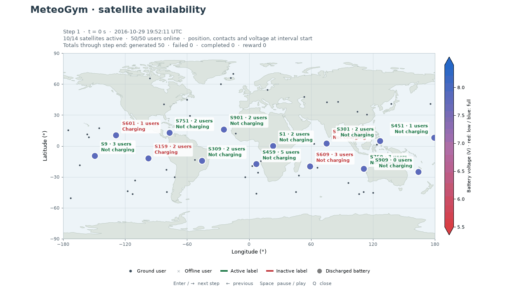

# MeteoGym

MeteoGym is a Python/Gymnasium environment for controlling which LEO satellites accept tasks from ground users while respecting battery availability.

- [`src/`](src/README.md): installable simulator, command-line interface and tests.
- [`plots/plot_results.py`](plots/plot_results.py): Matplotlib map playback of saved runs.
- [`presentacion/`](presentacion/): Presentation of the research problem (in spanish).

## System prerequisites

Use Python 3.11 or later.
Install the following system packages before creating the virtual environment.
The commands include Tk support for interactive plot windows; Tk is optional for simulations and plot exports without a window.

Ubuntu 24.04 or later:

```bash
sudo apt update
sudo apt install python3 python3-venv python3-pip python3-tk
```

Arch Linux:

```bash
sudo pacman -Syu --needed python python-pip tk
```

For more details check the [system prerequisites and plotting checks](src/README.md#system-prerequisites).

## Install

From the repository root, create the virtual environment and install MeteoGym with pip:

```bash
python3 -m venv .venv
source .venv/bin/activate
python -m pip install ./src
meteogym run --satellites 1 541 --users 100 --duration 5400 --step 10 --seed 10
```

Installation resolves compatible runtime dependencies automatically.
For development, install the test and plotting extras in the same virtual environment:

```bash
python -m pip install -e './src[dev,plot]'
python -m pytest src/tests
python -m ruff check src
```

The bundled constellation contains 1,080 synthetic satellites.
Only the selected ids in  `--satellites` parameters are used in the episode.
Simulations start at the epoch October 2016 by default.
The initial timestamp can be changed using the `--start-time` parameter in ISO 8601 format.
See the [simulator README](src/README.md) for workload, energy assumptions, contact-table export, and experiment configuration.
Its [Gymnasium example](src/README.md#gymnasium-api) shows how to pass observations to your own model and use its binary satellite actions in `env.step()`.

Plot an existing output with animation or press Enter in the plot window to advance one step.
Assuming an output directory with path `./outputs/run`

```bash
python -m pip install './src[plot]'
python -m  meteogym.plots.plot_results ./outputs/run --mode animate
python -m  meteogym.plots.plot_results ./outputs/run --mode step
```

Add `--plot` or `--plot step` to `meteogym run` to open the viewer after the simulation finishes.
Interactive plotting requires access to a graphical desktop session.
See [interactive plotting setup](src/README.md#check-interactive-plotting) if Matplotlib selects a backend that cannot open windows.

